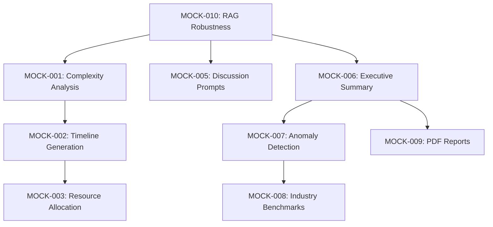

# Mock Services & AI Implementation Backlog

**Purpose:** Track the transition from Mock/Stub implementations to Real AI/Functional services to ensure full system functionality.  
**Source:** System Analysis (Mock Service Identification Task).  
**Last Updated:** February 1, 2026

---

## How to Use This Backlog

- **Order:** Implement items by priority (High → Medium → Low).
- **Priority:** High = Core AI Features, Medium = Enhanced UX, Low = Optimization/Polish.
- **Verification:** After each implementation, verify `is_mock: false` in API responses.

---

## Priority Legend

| Code   | Meaning                                      |
|--------|----------------------------------------------|
| High   | Core AI features blocking production quality |
| Medium | Enhanced functionality for better UX         |
| Low    | Optimization and polish items                |

---

## Backlog Items

### 1. AI Roadmap Generator (RoadmapService)

**Location:** `server/app/services/roadmap_service.py`

---

#### MOCK-001 — Real AI Complexity Analysis
- **Priority:** High  
- **Current State:** Returns hardcoded complexity (6.5) and flat averages when in mock mode.
- **Target State:** Integrate LLM to analyze `UseCase` title and description. Return estimated complexity (1-10) with reasoning factors (data availability, technical difficulty, integration risk).
- **Implementation Notes:**
  - Use existing `self.llm` when available
  - Parse structured JSON response from LLM
  - Add confidence score to output
- **Verification:** Call `/api/roadmap/complexity` with valid use cases; response should have `is_mock: false`.

---

#### MOCK-002 — Dynamic Timeline Generation
- **Priority:** Medium  
- **Current State:** Uses static standard phases (Discovery, Design, Build, Test, Deploy) and fixed duration logic.
- **Target State:** Use LLM to generate custom phases and tasks specific to the use case type (e.g., "GenAI Chatbot" vs. "Predictive Maintenance" should have different lifecycles).
- **Implementation Notes:**
  - Create LLM prompt for phase generation
  - Map AI-generated phases to database schema
  - Allow user override of AI suggestions
- **Verification:** Different use case types should produce different phase structures.

---

#### MOCK-003 — Intelligent Resource Allocation
- **Priority:** Low  
- **Current State:** Hardcoded role mapping (e.g., "Discovery" always needs "Product Manager 0.5 FTE").
- **Target State:** AI recommends specific roles and skills based on the technical requirements of the use case stack.
- **Implementation Notes:**
  - Analyze proposed solution text for technology keywords
  - Map to skill requirements dynamically
  - Consider organization's existing resource pool
- **Verification:** Resource recommendations should vary based on use case technical complexity.

---

### 2. AI Copilot (CopilotService)

**Location:** `server/app/services/copilot_service.py`

---

#### MOCK-004 — Real-time Suggestion Engine
- **Priority:** High  
- **Current State:** Rule-based logic (e.g., "if votes < X show message") with static thresholds.
- **Target State:** Full LLM analysis of workshop activity (Intake rates, Voting patterns, Chat/Transcript if available) to suggest nuanced interventions.
- **Implementation Notes:**
  - Batch workshop state into context window
  - Generate suggestions with action types
  - Implement suggestion caching to reduce API calls
- **Verification:** Suggestions should reference specific participant names and use case content.

---

#### MOCK-005 — Contextual Discussion Prompts
- **Priority:** High  
- **Current State:** Returns hardcoded generic questions (e.g., "Who are the key stakeholders?") in `_get_mock_discussion_prompts`.
- **Target State:** LLM generates specific, challenging discussion questions based on the *content* of the submitted use cases.
- **Implementation Notes:**
  - Include use case title, description, and proposed solution in prompt
  - Generate 4-5 targeted questions per use case
  - Include variance data context when available
- **Verification:** Questions should mention specific aspects of the use case content.

---

#### MOCK-006 — AI Executive Summary
- **Priority:** High  
- **Current State:** `_generate_mock_summary` returns templated strings with placeholder content.
- **Target State:** LLM synthesizes all workshop data (Use Cases, Votes, Engagement, Quadrants) into a cohesive professional narrative.
- **Implementation Notes:**
  - Aggregate scored use cases and engagement metrics
  - Support multiple formats (executive, detailed, technical)
  - Generate actionable next steps
- **Verification:** Summary should contain specific use case names and calculated metrics.

---

#### MOCK-007 — Anomaly Detection Enhancement
- **Priority:** Medium  
- **Current State:** Simple statistical checks (Std Dev) labeled as "AI Detection".
- **Target State:** Advanced pattern matching using AI to detect semantic duplicates, groupthink (semantic similarity of votes), or bias patterns.
- **Implementation Notes:**
  - Use embeddings for semantic similarity
  - Implement voting pattern analysis
  - Generate explanations for detected anomalies
- **Verification:** Should detect subtle patterns not caught by statistical thresholds.

---

### 3. Analytics & Reporting (Analytics API)

**Location:** `server/app/api/analytics.py`

---

#### MOCK-008 — Real Industry Benchmarking
- **Priority:** Low  
- **Current State:** Returns hardcoded `BenchmarkMetric` objects with static numbers.
- **Target State:**
  1. Create database tables for industry benchmarks
  2. Populate with real or realistic seed data
  3. Query against organization sector/size
- **Implementation Notes:**
  - Design `IndustryBenchmark` schema if not exists
  - Create seed data for common industries
  - Add organization industry field if missing
- **Verification:** Different industries should return different benchmark values.

---

#### MOCK-009 — PDF Report Generation
- **Priority:** Medium  
- **Current State:** Returns fake URL `https://storage.qbrainlabs.com/reports/{uuid}.pdf`.
- **Target State:**
  1. Implement PDF generation (e.g., via `reportlab` or `weasyprint`)
  2. Generate actual charts/graphs
  3. Store in local storage or cloud
  4. Return valid download URL
- **Implementation Notes:**
  - Use `matplotlib` or `plotly` for charts
  - Template-based PDF layout
  - Background task for generation
- **Verification:** Download URL should return a valid PDF with actual data.

---

### 4. RAG Enhancement Features (RAGService)

**Location:** `server/app/services/rag_service.py`

---

#### MOCK-010 — Robust AI Business Case & ROI Generation
- **Priority:** High  
- **Current State:** `enhance_use_case`, `estimate_roi`, `generate_business_case` have fallback mock blocks used when API keys are missing.
- **Target State:**
  1. Robust error handling (don't silently fallback to mock in production)
  2. Validate prompt templates against real LLM
  3. Implement "Retry" logic or "Partial" results instead of full mock
- **Implementation Notes:**
  - Add explicit mock mode logging/alerts
  - Implement retry with exponential backoff
  - Return partial results with error indicators
- **Verification:** Production should never return `is_mock: true`; errors should be explicit.

---

### 5. Challenge Cards (ChallengeStepService)

**Location:** `server/app/services/challenge_step_service.py`

---

#### MOCK-011 — AI Challenge Step Summarization
- **Priority:** High  
- **Current State:** `generate_step_summary` uses f-strings to fill templates with placeholder text, ignoring actual step inputs.
- **Target State:**
  1. Capture outputs from the previous step
  2. Send to LLM with `summary_template`
  3. Return actual summarized content for the slide/card
- **Implementation Notes:**
  - Store step outputs in database
  - Pass accumulated context through steps
  - Support both AI-generated and user-edited content
- **Verification:** Summary should reference actual data entered in previous steps.

---

## Summary Table

| ID       | Priority | Service              | Description                          |
|----------|----------|----------------------|--------------------------------------|
| MOCK-001 | High     | RoadmapService       | Real AI Complexity Analysis          |
| MOCK-004 | High     | CopilotService       | Real-time Suggestion Engine          |
| MOCK-005 | High     | CopilotService       | Contextual Discussion Prompts        |
| MOCK-006 | High     | CopilotService       | AI Executive Summary                 |
| MOCK-010 | High     | RAGService           | Robust Business Case/ROI Generation  |
| MOCK-011 | High     | ChallengeStepService | AI Challenge Step Summarization      |
| MOCK-002 | Medium   | RoadmapService       | Dynamic Timeline Generation          |
| MOCK-007 | Medium   | CopilotService       | Anomaly Detection Enhancement        |
| MOCK-009 | Medium   | Analytics API        | PDF Report Generation                |
| MOCK-003 | Low      | RoadmapService       | Intelligent Resource Allocation      |
| MOCK-008 | Low      | Analytics API        | Real Industry Benchmarking           |

---

## Implementation Dependencies

---

## Changelog

| Date       | Change                                                                 |
|------------|------------------------------------------------------------------------|
| 2026-02-01 | Initial backlog created from mock service identification analysis.    |
