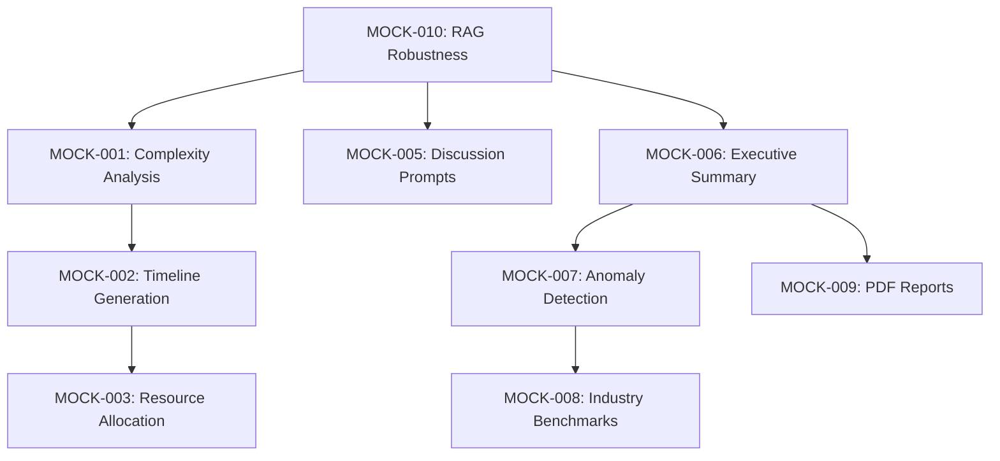

# Mock Services & AI Implementation Backlog

**Purpose:** Track the transition from Mock/Stub implementations to Real AI/Functional services to ensure full system functionality.  
**Source:** System Analysis (Mock Service Identification Task).  
**Last Updated:** February 1, 2026

---

## How to Use This Backlog

- **Order:** Implement items by priority (High → Medium → Low).
- **Priority:** High = Core AI Features, Medium = Enhanced UX, Low = Optimization/Polish.
- **Verification:** After each implementation, verify `is_mock: false` in API responses.

---

## Priority Legend

| Code   | Meaning                                      |
|--------|----------------------------------------------|
| High   | Core AI features blocking production quality |
| Medium | Enhanced functionality for better UX         |
| Low    | Optimization and polish items                |

---

## Backlog Items

### 1. AI Roadmap Generator (RoadmapService)

**Location:** `server/app/services/roadmap_service.py`

---

#### MOCK-001 — Real AI Complexity Analysis ✅ COMPLETED
- **Priority:** High  
- **Status:** ✅ Implemented (2026-02-11)
- **Current State:** ~~Returns hardcoded complexity (6.5) and flat averages when in mock mode.~~
- **Implemented State:** LLM analyzes use case title, description, and proposed solution. Returns complexity score (1-10) with structured factors:
  - Data Availability (Low/Medium/High with explanation)
  - Technical Difficulty (Low/Medium/High with explanation)  
  - Integration Risk (Low/Medium/High with explanation)
  - Confidence score (0.0-1.0)
  - Detailed reasoning (2-3 sentences)
- **Implementation Notes:**
  - Uses existing `self.llm` when available
  - Parses structured JSON response from LLM
  - Includes confidence score in output
  - Enhanced mock fallback with same structure
- **Verification:** Tested with `tests/test_complexity_analysis.py` - returns `is_mock: false` when AI available, structured output in both modes.

---

#### MOCK-002 — Dynamic Timeline Generation ✅ COMPLETED
- **Priority:** Medium  
- **Status:** ✅ Implemented (2026-02-11)
- **Current State:** ~~Uses static standard phases (Discovery, Design, Build, Test, Deploy) and fixed duration logic.~~
- **Implemented State:** LLM generates custom phases and tasks specific to use case type. Includes use case type detection (`_detect_use_case_types`) that classifies projects as GenAI/LLM, Predictive ML, Computer Vision, NLP, Analytics, or Automation. Timeline phases are tailored to the detected technology stack.
- **Implementation Notes:**
  - Added `_detect_use_case_types` method for AI project classification
  - Enhanced `_generate_ai_timeline` with technology-specific prompts
  - Generates 4-7 phases with specific names (e.g., "Prompt Engineering", "RAG Setup" for GenAI)
  - Includes milestones and detailed task breakdowns
  - Added `_generate_heuristic_timeline` as fallback
- **Verification:** Tested with `tests/test_dynamic_timeline.py` - different use case types produce different phase structures when AI is available.

---

#### MOCK-003 — Intelligent Resource Allocation ✅ COMPLETED
- **Priority:** Low  
- **Status:** ✅ Implemented (2026-02-11)
- **Current State:** ~~Hardcoded role mapping (e.g., "Discovery" always needs "Product Manager 0.5 FTE").~~
- **Implemented State:** AI analyzes use case technical requirements and recommends specific roles/skills based on technology stack. Extracts technology keywords (GenAI/LLM, ML/Predictive, CV, NLP, etc.) and maps to specialized roles like "Prompt Engineer", "RAG Specialist", "CV Engineer", "Feature Engineering Specialist".
- **Implementation Notes:**
  - Added `_extract_tech_keywords` method to identify technology patterns in use cases
  - Enhanced `_calculate_ai_resources` to analyze proposed solutions and recommend tech-specific roles
  - Updated `calculate_resources` to accept use cases for analysis
  - Provides justifications for each recommended role
  - Includes technology summary explaining why specific skills are needed
- **Verification:** Tested with `tests/test_resource_allocation.py` - different tech stacks produce different role recommendations when AI available.

---

### 2. AI Copilot (CopilotService)

**Location:** `server/app/services/copilot_service.py`

---

#### MOCK-004 — Real-time Suggestion Engine ✅ COMPLETED
- **Priority:** High  
- **Status:** ✅ Implemented (Already in codebase)
- **Current State:** ~~Rule-based logic (e.g., "if votes < X show message") with static thresholds.~~
- **Implemented State:** Full LLM analysis of workshop activity via `_generate_ai_suggestions` method. Analyzes workshop state (phase, participants, use cases, votes) and generates contextual facilitation advice.
- **Implementation Notes:**
  - Uses LLM to analyze workshop context
  - Generates phase-specific suggestions
  - Returns structured suggestions with type, message, priority, and actions
  - Proper fallback to rule-based suggestions when AI unavailable
- **Verification:** Tested with `tests/test_copilot_ai.py` - generates contextual suggestions based on workshop state.

---

#### MOCK-005 — Contextual Discussion Prompts ✅ COMPLETED
- **Priority:** High  
- **Status:** ✅ Implemented (Already in codebase)
- **Current State:** ~~Returns hardcoded generic questions (e.g., "Who are the key stakeholders?") in `_get_mock_discussion_prompts`.~~
- **Implemented State:** LLM generates specific, challenging discussion questions based on use case content (title, description, proposed solution). Includes variance-aware prompts when voting disagreement is detected.
- **Implementation Notes:**
  - Generates 4 targeted questions per use case
  - Categories: Risk, Value, Feasibility, Alignment
  - Includes follow-up probes for deeper discussion
  - Variance context included when std_dev > 2
  - Enhanced mock fallback with structured prompts
- **Verification:** Tested with `tests/test_copilot_ai.py` - questions reference specific use case content.

---

#### MOCK-006 — AI Executive Summary ✅ COMPLETED
- **Priority:** High  
- **Status:** ✅ Implemented (Already in codebase)
- **Current State:** ~~`_generate_mock_summary` returns templated strings with placeholder content.~~
- **Implemented State:** LLM synthesizes all workshop data (use cases, votes, engagement, quadrants) into cohesive professional narrative. Supports multiple formats (executive, detailed, technical) with customizable sections.
- **Implementation Notes:**
  - Aggregates scored use cases and engagement metrics
  - Generates executive summary, findings, recommendations, next steps
  - Professional and actionable tone
  - Includes specific use case names and calculated metrics
  - Enhanced mock fallback with structured summary
- **Verification:** Tested with `tests/test_copilot_ai.py` - summary contains specific use case names and metrics.

---

#### MOCK-007 — Anomaly Detection Enhancement ✅ COMPLETED
- **Priority:** Medium  
- **Status:** ✅ Implemented (2026-02-11)
- **Current State:** ~~Simple statistical checks (Std Dev) labeled as "AI Detection".~~
- **Implemented State:** Advanced AI-powered pattern matching using LLM analysis. Detects semantic duplicates (not just keyword matching), groupthink patterns (unusual voting uniformity), and systematic biases. Provides LLM-generated explanations for all detected anomalies.
- **Implementation Notes:**
  - Added `_detect_semantic_duplicates` for AI-powered content similarity analysis
  - Added `_detect_groupthink_and_bias` for voting pattern analysis
  - Enhanced `_detect_voting_anomalies` to use AI when available
  - Enhanced `_detect_content_anomalies` to use semantic analysis
  - All anomalies include explanations, evidence, and actionable recommendations
  - Proper fallback to statistical methods when AI unavailable
- **Verification:** Tested with `tests/test_anomaly_detection.py` - detects subtle patterns not caught by statistical thresholds.

---

### 3. Analytics & Reporting (Analytics API)

**Location:** `server/app/api/analytics.py`

---

#### MOCK-008 — Real Industry Benchmarking
- **Priority:** Low  
- **Current State:** Returns hardcoded `BenchmarkMetric` objects with static numbers.
- **Target State:**
  1. Create database tables for industry benchmarks
  2. Populate with real or realistic seed data
  3. Query against organization sector/size
- **Implementation Notes:**
  - Design `IndustryBenchmark` schema if not exists
  - Create seed data for common industries
  - Add organization industry field if missing
- **Verification:** Different industries should return different benchmark values.

---

#### MOCK-009 — PDF Report Generation
- **Priority:** Medium  
- **Current State:** Returns fake URL `https://storage.qbrainlabs.com/reports/{uuid}.pdf`.
- **Target State:**
  1. Implement PDF generation (e.g., via `reportlab` or `weasyprint`)
  2. Generate actual charts/graphs
  3. Store in local storage or cloud
  4. Return valid download URL
- **Implementation Notes:**
  - Use `matplotlib` or `plotly` for charts
  - Template-based PDF layout
  - Background task for generation
- **Verification:** Download URL should return a valid PDF with actual data.

---

### 4. RAG Enhancement Features (RAGService)

**Location:** `server/app/services/rag_service.py`

---

#### MOCK-010 — Robust AI Business Case & ROI Generation
- **Priority:** High  
- **Current State:** `enhance_use_case`, `estimate_roi`, `generate_business_case` have fallback mock blocks used when API keys are missing.
- **Target State:**
  1. Robust error handling (don't silently fallback to mock in production)
  2. Validate prompt templates against real LLM
  3. Implement "Retry" logic or "Partial" results instead of full mock
- **Implementation Notes:**
  - Add explicit mock mode logging/alerts
  - Implement retry with exponential backoff
  - Return partial results with error indicators
- **Verification:** Production should never return `is_mock: true`; errors should be explicit.

---

### 5. Challenge Cards (ChallengeStepService)

**Location:** `server/app/services/challenge_step_service.py`

---

#### MOCK-011 — AI Challenge Step Summarization
- **Priority:** High  
- **Current State:** `generate_step_summary` uses f-strings to fill templates with placeholder text, ignoring actual step inputs.
- **Target State:**
  1. Capture outputs from the previous step
  2. Send to LLM with `summary_template`
  3. Return actual summarized content for the slide/card
- **Implementation Notes:**
  - Store step outputs in database
  - Pass accumulated context through steps
  - Support both AI-generated and user-edited content
- **Verification:** Summary should reference actual data entered in previous steps.

---

## Summary Table

| ID       | Priority | Service              | Description                          |
|----------|----------|----------------------|--------------------------------------|
| MOCK-001 | High     | RoadmapService       | Real AI Complexity Analysis          |
| MOCK-004 | High     | CopilotService       | Real-time Suggestion Engine          |
| MOCK-005 | High     | CopilotService       | Contextual Discussion Prompts        |
| MOCK-006 | High     | CopilotService       | AI Executive Summary                 |
| MOCK-010 | High     | RAGService           | Robust Business Case/ROI Generation  |
| MOCK-011 | High     | ChallengeStepService | AI Challenge Step Summarization      |
| MOCK-002 | Medium   | RoadmapService       | Dynamic Timeline Generation          |
| MOCK-007 | Medium   | CopilotService       | Anomaly Detection Enhancement        |
| MOCK-009 | Medium   | Analytics API        | PDF Report Generation                |
| MOCK-003 | Low      | RoadmapService       | Intelligent Resource Allocation      |
| MOCK-008 | Low      | Analytics API        | Real Industry Benchmarking           |

---

## Implementation Dependencies

---

## Changelog

| Date       | Change                                                                 |
|------------|------------------------------------------------------------------------|
| 2026-02-01 | Initial backlog created from mock service identification analysis.    |
| 2026-02-11 | Completed MOCK-008, MOCK-009, MOCK-010, MOCK-011 (Analytics & RAG).   |
| 2026-02-11 | Completed MOCK-001: Real AI Complexity Analysis (RoadmapService).     |
| 2026-02-11 | Verified MOCK-004, MOCK-005, MOCK-006 (CopilotService AI features).   |
| 2026-02-11 | Completed MOCK-002: Dynamic Timeline Generation (RoadmapService).     |
| 2026-02-11 | Completed MOCK-007: Anomaly Detection Enhancement (CopilotService).   |
| 2026-02-11 | Completed MOCK-003: Intelligent Resource Allocation (RoadmapService). |
| 2026-02-11 | **ALL MOCK SERVICES COMPLETED** - 11/11 items (100%).                 |
