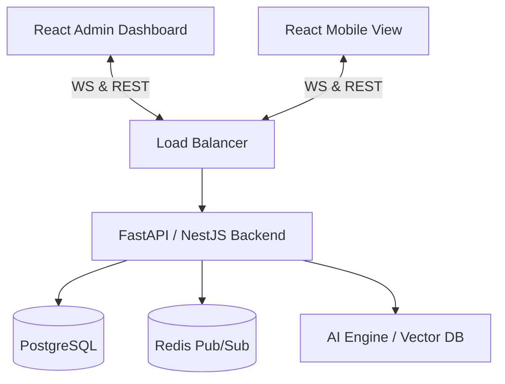

# Qbrain AI Labs - Technical Specification

**Version:** 2.0
**Status:** Approved
**Last Updated:** 2026-01-23

---

## 1. System Overview
Qbrain AI Labs is a real-time collaborative workshop platform tailored for AI strategic planning. It allows a facilitator to guide a group of stakeholders through **ideation**, **scoring**, and **visualization** of AI use cases. The core value is the "Qbrain AI Labs," a dynamic 2x2 chart that renders live participant feedback into a strategic roadmap (Feasibility vs. Value).

---

## 2. Architecture

The system uses a **Real-Time Event-Driven Architecture**.
* **Role separation:** Distinct interfaces for **Facilitators** (Admin/Dashboards) and **Participants** (Mobile-first/Canvas).
* **State Sync:** Heavy reliance on WebSockets to ensure all screens view the same "Phase" of the workshop simultaneously.

### High-Level Diagram


---

## 3. Technology Stack

| Layer | Technology | Decision Rationale |
| :--- | :--- | :--- |
| **Frontend** | **React.js + Vite** | Fast rendering, rich ecosystem for drag-and-drop. |
| **Styling** | **Tailwind CSS** | Rapid UI development, mobile-first utility classes. |
| **State** | **Zustand + React Query** | Lightweight global state for workshop phases; Query for async data. |
| **Visualization** | **D3.js** | Low-level control over SVG elements for the custom interactive Matrix. |
| **Backend** | **Python (FastAPI)** | Native integration with AI/ML libraries; high-performance async support. |
| **Database** | **PostgreSQL** | Relational integrity for Votes, Workshops, and Users. |
| **Real-Time** | **Socket.io** | Robust fallback for WebSockets; easy room management. |
| **Cache** | **Redis** | Storing ephemeral session state (who is online, active card index). |

---

## 4. Database Schema (PostgreSQL)

### `workshops`
| Column | Type | Notes |
| :--- | :--- | :--- |
| `id` | UUID | PK |
| `facilitator_id` | UUID | FK -> Users |
| `pin` | VARCHAR(6) | Unique entry code (Index) |
| `title` | TEXT | |
| `status` | ENUM | `DRAFT`, `OPEN`, `IN_PROGRESS`, `COMPLETED` |
| `current_phase` | ENUM | `INTAKE`, `SCORING`, `ANALYSIS` |
| `config` | JSONB | Stores weighted criteria config or Template ID (e.g., "7_POINT_COMPREHENSIVE") |

### `participants`
| Column | Type | Notes |
| :--- | :--- | :--- |
| `id` | UUID | PK |
| `workshop_id` | UUID | FK -> Workshops |
| `display_name` | VARCHAR | |
| `session_token` | TEXT | For reconnection |
| `is_online` | BOOLEAN | |

### `use_cases`
| Column | Type | Notes |
| :--- | :--- | :--- |
| `id` | UUID | PK |
| `workshop_id` | UUID | FK -> Workshops |
| `author_id` | UUID | FK -> Participants |
| `title` | TEXT | |
| `description` | TEXT | |
| `kpi` | TEXT | |
| `category` | VARCHAR | e.g. "GenAI", "Predictive" |
| `status` | ENUM | `DRAFT`, `SUBMITTED`, `REJECTED` |

### `votes`
| Column | Type | Notes |
| :--- | :--- | :--- |
| `id` | UUID | PK |
| `use_case_id` | UUID | FK -> UseCases |
| `participant_id` | UUID | FK -> Participants (Anonymized in UI) |
| `criteria_name` | VARCHAR | e.g. "Feasibility" |
| `score` | INTEGER | 1-10 Scale |
| `skipped` | BOOLEAN | If user abstained |

---

## 5. API Specification (REST)

### Auth & Entry
* `POST /api/workshops/join`
    * Body: `{ pin: "123456", name: "Alice" }`
    * Returns: `{ token: "jwt...", workshop_state: {...} }`

### Workshop Management
* `POST /api/workshops` (Facilitator Only)
* `PATCH /api/workshops/{id}/state`
    * Body: `{ phase: "SCORING", active_card_id: "xyz" }`
    * **Effect:** Triggers WS broadcast `state_change`.

### Content
* `POST /api/usecases`
    * Payload: `{ title, problem, solution, category }`
* `GET /api/workshops/{id}/results`
    * Returns aggregated math: `[{ use_case_id, x: 8.5, y: 4.2, std_dev: 1.1 }]`

### Scoring
* `POST /api/votes`
    * Body: `{ use_case_id, scores: { "Value": 8, "Feas": 3 } }`
    * **Async:** Pushed to BullMQ for processing if high load.

---

## 6. Real-Time Event Architecture (Socket.io)

### Rooms
* `workshop_{id}_admin`: Only facilitator (receives raw stream).
* `workshop_{id}_public`: All participants.

### Events
| Event Name | Direction | Payload | Description |
| :--- | :--- | :--- | :--- |
| `client:join` | -> Server | `{ token }` | Handshake & Reconnect. |
| `server:state_change` | -> Client | `{ phase: "SCORING" }` | Forces UI to change view. |
| `client:submit_case` | -> Server | `{ case_data }` | New idea submitted. |
| `server:new_case` | -> Admin | `{ case_data }` | Adds to Facilitator feed. |
| `server:active_card` | -> Client | `{ card_id }` | **Lock-step scoring**: everyone sees same card. |
| `client:vote` | -> Server | `{ scores }` | Participant submits score. |
| `server:update_matrix` | -> Admin | `{ use_case_id, new_coords }` | Live updates D3 chart. |

---

## 7. Logic & Algorithms

### Weighting Engine & Aggregation
The system supports both custom weighted criteria and standardized templates.

**For the "Comprehensive 7-Point" Template (US10):**
Inputs: 7 dimensions (1-10 scale).
Mapping:
*   **Y-Axis (Value):** `AVG(Business Impact, Strategic Alignment, Scalability & Value)`
*   **X-Axis (Feasibility):** `AVG(Ease of Implementation, Data Readiness, Organizational Readiness, (11 - Risk & Compliance))`
    *   *Note on Risk:* Inverted scale (High Risk = Low Feasibility).

**For Custom Weights:**
Formula for calculating specific axis coordinates:
```python
def calculate_score(votes, criteria_config):
    # criteria_config = { "ROI": 0.6, "Revenue": 0.4 } -> mapped to Y-Axis
    total_score = 0
    for vote in votes:
        weight = criteria_config.get(vote.criteria_name)
        total_score += vote.score * weight
    return total_score / count(votes)
```

### Quadrant Logic
* **Quick Wins:** X > 50, Y > 50
* **Strategic Bets:** X < 50, Y > 50
* **Low Hanging:** X > 50, Y < 50
* **Time Sinks:** X < 50, Y < 50

---

## 8. Security & Constraints

* **Rate Limiting:** Aggressive limiting on PIN guessing (5 attempts / min).
* **Sanitization:** All text inputs stripped of script tags.
* **Concurrency:** Redis atomic counters used to track "Votes Received" vs "Total Participants" for progress bars.
