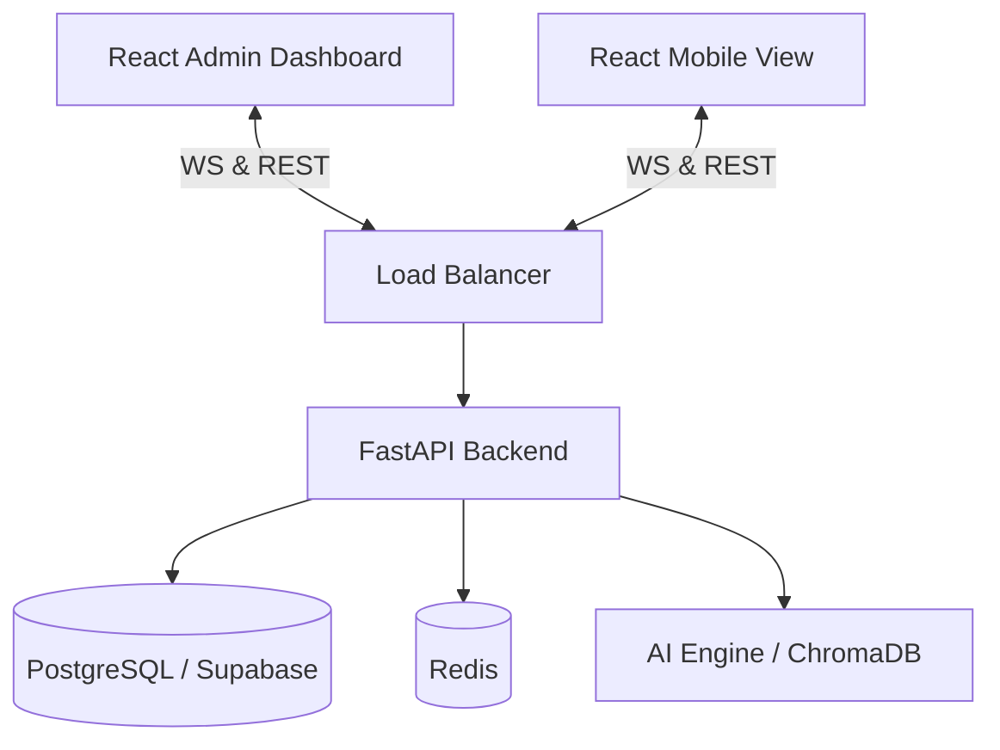

# Qbrain AI Labs - Technical Specification

**Version:** 3.0
**Status:** Approved
**Last Updated:** 2026-02-21

---

## 1. System Overview
Qbrain AI Labs is a real-time collaborative workshop platform tailored for AI strategic planning. It allows a facilitator to guide a group of stakeholders through **ideation**, **scoring**, and **visualization** of AI use cases. The core value is the "Qbrain AI Labs," a dynamic 2x2 chart that renders live participant feedback into a strategic roadmap (Feasibility vs. Value). The application includes admin panels, surveys, gamification, live polling, breakout rooms, ROI calculator, roadmap generator, AI copilot, knowledge base, and multi-language support.

---

## 2. Architecture

The system uses a **Real-Time Event-Driven Architecture**.
* **Role separation:** Distinct interfaces for **Facilitators** (Admin/Dashboards) and **Participants** (Mobile-first/Canvas).
* **State Sync:** Heavy reliance on WebSockets (Socket.IO) to keep workshop phase, active card, and votes in sync across clients.
* **Backend:** Single Python FastAPI application (no NestJS); optional load balancer in front for production.

### High-Level Diagram


---

## 3. Technology Stack

Stack reflects current implementation (see `client/package.json`, `server/requirements.txt`).

### Frontend (Client)

| Layer | Technology | Version / Notes |
| :--- | :--- | :--- |
| **Runtime** | React | 19.x |
| **Build** | Vite | 7.x |
| **Language** | TypeScript | 5.9 |
| **Styling** | Tailwind CSS | 4.x (PostCSS) |
| **Routing** | React Router | 7.x |
| **HTTP** | Axios | 1.x |
| **Real-Time** | socket.io-client | 4.x |
| **Charts** | Recharts, D3 | Recharts 3.x, D3 7.x |
| **Animation** | Framer Motion | 12.x |
| **i18n** | i18next, react-i18next | 25.x / 16.x |
| **UI** | Lucide React (icons), Sonner (toasts) | - |
| **QR** | qrcode.react | 4.x |
| **Testing** | Vitest, Playwright, Testing Library | - |

**Rationale:** Vite for fast HMR and builds; React 19 and TypeScript for type safety; Tailwind for utility-first styling; Socket.IO client for real-time; Recharts/D3 for matrix and analytics.

### Backend (Server)

| Layer | Technology | Version / Notes |
| :--- | :--- | :--- |
| **Framework** | FastAPI | 0.104.x |
| **ASGI** | Uvicorn, Gunicorn | Production |
| **ORM** | SQLAlchemy | 2.x (async) |
| **Database** | PostgreSQL | Via asyncpg / psycopg; Supabase optional |
| **Migrations** | Alembic | 1.12.x |
| **Validation** | Pydantic | 2.x |
| **Auth** | PyJWT, python-jose, passlib (bcrypt) | JWT + bcrypt |
| **Real-Time** | python-socketio | 5.x (Socket.IO server) |
| **Cache / Rate Limit** | Redis | 5.x (hiredis optional) |
| **AI / ML** | OpenAI, LangChain, ChromaDB | RAG, embeddings, vector store |
| **Documents** | python-docx, python-pptx, pypdf, openpyxl, reportlab | Export / business case |
| **Logging** | structlog, python-json-logger | Structured logs |
| **Monitoring** | prometheus-client, sentry-sdk | Metrics and error tracking |
| **Testing** | pytest, pytest-asyncio, pytest-cov, httpx | API tests |

**Rationale:** FastAPI for async and OpenAPI; SQLAlchemy 2 async with PostgreSQL; python-socketio for Socket.IO compatibility with client; Redis for sessions/rate limiting; OpenAI/LangChain/ChromaDB for RAG and AI features.

### Infrastructure & Ops

| Area | Technology |
| :--- | :--- |
| **Database** | PostgreSQL (Supabase or self-hosted) |
| **Cache** | Redis |
| **Real-Time** | Socket.IO (mounted at `/ws`) |
| **Static** | FastAPI StaticFiles (e.g. `/static` for reports) |
| **CORS** | Dynamic or configurable origins via env |
| **Security** | Rate limiting, security headers, optional Sentry |

---

## 4. API Modules (Current)

Routers mounted in `server/app/main.py`. Prefixes and tags as of current implementation.

| Prefix / Tag | Purpose |
| :--- | :--- |
| `/api/workshops` | Workshop CRUD, phase, state |
| `/api/participants`, `/api` | Join, session, role (facilitator queue) |
| `/api/usecases` | Use case CRUD |
| `/api/votes` | Vote submit, matrix positions |
| `/api/results` | Aggregated results |
| `/api/ai` | Enhance, feasibility, duplicates, business-value, ROI, business-case, analyze-file |
| `/api/knowledge-base` | RAG admin (ingest, search, migrate) |
| `/api/auth` | Facilitator signup, login, me, change-password, register, logout |
| `/api/admin` | Stats, workshops, users, LLM usage, use case import, knowledge-base migration |
| `/api/admin/settings` | System settings, audit log, cache invalidation, seed |
| `/api/admin/settings` (subscription) | Subscription tiers, feature flags |
| `/api/knowledge-base` (public) | Knowledge base read/search |
| `/api/surveys` | Survey CRUD, questions, activate/pause/close, submit, progress, results, templates |
| `/api/participant-auth` | Participant register, login, join-anonymous/registered, me, profile, stats |
| `/api/analytics` | Workshop analytics |
| `/api/export` | PDF/CSV export for workshop results |
| `/api/organizations` | Organizations CRUD, members, invitations, workshops, analytics |
| `/api/marketplace` | Template marketplace |
| `/api/facilitators` | Workshop-facilitator assignment |
| `/api/member` | Member session (join, workshop, leave, refresh) |
| `/api/feedback` | Feedback, onboarding, help articles, tooltips, tours |
| `/api/analytics` (dashboard) | Advanced analytics/reporting |
| `/api/polls` | Polls, vote, reactions, Q&A |
| `/api/gamification` | Points, badges, leaderboards |
| `/api/roi` | ROI calculate, estimate, business-case |
| `/api/templates` | Workshop templates, industry packages, use-case library, criteria templates |
| `/api` (breakout) | Breakout rooms (create, join, start, end, canvas, messages, broadcast) |
| `/api/roadmaps` | Roadmap generate, CRUD, resources, critical-path |
| `/api/challenges` | Challenge cards CRUD, reorder, step generate |
| `/api` (copilot) | AI copilot |
| `/api` (knowledge_validation) | Knowledge validation |
| `/api/notifications` | Notifications |
| `/api` (data_sources) | Data sources |

Full request/response contracts: see OpenAPI at `/docs` and `/redoc`.

---

## 5. Database Schema (PostgreSQL)

> **Detailed schema:** See [database-design.md](./database-design.md) for full table definitions, indexes, and conventions. Summary below.

### `workshops`
| Column | Type | Notes |
| :--- | :--- | :--- |
| `id` | UUID | PK |
| `facilitator_id` | UUID | FK -> Users |
| `pin` | VARCHAR(6) | Unique entry code (Index) |
| `title` | TEXT | |
| `status` | ENUM | `DRAFT`, `OPEN`, `IN_PROGRESS`, `COMPLETED` |
| `current_phase` | ENUM | `INTAKE`, `SCORING`, `ANALYSIS` |
| `config` | JSONB | Stores weighted criteria config or Template ID (e.g., "7_POINT_COMPREHENSIVE") |

### `participants`
| Column | Type | Notes |
| :--- | :--- | :--- |
| `id` | UUID | PK |
| `workshop_id` | UUID | FK -> Workshops |
| `display_name` | VARCHAR | |
| `session_token` | TEXT | For reconnection |
| `is_online` | BOOLEAN | |

### `use_cases`
| Column | Type | Notes |
| :--- | :--- | :--- |
| `id` | UUID | PK |
| `workshop_id` | UUID | FK -> Workshops |
| `author_id` | UUID | FK -> Participants |
| `title` | TEXT | |
| `description` | TEXT | |
| `kpi` | TEXT | |
| `category` | VARCHAR | e.g. "GenAI", "Predictive" |
| `status` | ENUM | `DRAFT`, `SUBMITTED`, `REJECTED` |

### `votes`
| Column | Type | Notes |
| :--- | :--- | :--- |
| `id` | UUID | PK |
| `use_case_id` | UUID | FK -> UseCases |
| `participant_id` | UUID | FK -> Participants (Anonymized in UI) |
| `criteria_name` | VARCHAR | e.g. "Feasibility" |
| `score` | INTEGER | 1-10 Scale |
| `skipped` | BOOLEAN | If user abstained |

---

## 6. API Specification (REST) – Core Flows

### Auth & Entry
* `POST /api/workshops/join`
    * Body: `{ pin: "123456", name: "Alice" }`
    * Returns: `{ token: "jwt...", workshop_state: {...} }`

### Workshop Management
* `POST /api/workshops` (Facilitator Only)
* `PATCH /api/workshops/{id}/state`
    * Body: `{ phase: "SCORING", active_card_id: "xyz" }`
    * **Effect:** Triggers WS broadcast `state_change`.

### Content
* `POST /api/usecases`
    * Payload: `{ title, problem, solution, category }`
* `GET /api/workshops/{id}/results`
    * Returns aggregated math: `[{ use_case_id, x: 8.5, y: 4.2, std_dev: 1.1 }]`

### Scoring
* `POST /api/votes`
    * Body: `{ use_case_id, scores: { "Value": 8, "Feas": 3 } }`
    * **Async:** Pushed to BullMQ for processing if high load.

---

## 7. Real-Time Event Architecture (Socket.IO)

### Rooms
* `workshop_{id}_admin`: Only facilitator (receives raw stream).
* `workshop_{id}_public`: All participants.

### Events
| Event Name | Direction | Payload | Description |
| :--- | :--- | :--- | :--- |
| `client:join` | -> Server | `{ token }` | Handshake & Reconnect. |
| `server:state_change` | -> Client | `{ phase: "SCORING" }` | Forces UI to change view. |
| `client:submit_case` | -> Server | `{ case_data }` | New idea submitted. |
| `server:new_case` | -> Admin | `{ case_data }` | Adds to Facilitator feed. |
| `server:active_card` | -> Client | `{ card_id }` | **Lock-step scoring**: everyone sees same card. |
| `client:vote` | -> Server | `{ scores }` | Participant submits score. |
| `server:update_matrix` | -> Admin | `{ use_case_id, new_coords }` | Live updates D3 chart. |

---

## 8. Logic & Algorithms

### Weighting Engine & Aggregation
The system supports both custom weighted criteria and standardized templates.

**For the "Comprehensive 7-Point" Template (US10):**
Inputs: 7 dimensions (1-10 scale).
Mapping:
*   **Y-Axis (Value):** `AVG(Business Impact, Strategic Alignment, Scalability & Value)`
*   **X-Axis (Feasibility):** `AVG(Ease of Implementation, Data Readiness, Organizational Readiness, (11 - Risk & Compliance))`
    *   *Note on Risk:* Inverted scale (High Risk = Low Feasibility).

**For Custom Weights:**
Formula for calculating specific axis coordinates:
```python
def calculate_score(votes, criteria_config):
    # criteria_config = { "ROI": 0.6, "Revenue": 0.4 } -> mapped to Y-Axis
    total_score = 0
    for vote in votes:
        weight = criteria_config.get(vote.criteria_name)
        total_score += vote.score * weight
    return total_score / count(votes)
```

### Quadrant Logic
* **Quick Wins:** X > 50, Y > 50
* **Strategic Bets:** X < 50, Y > 50
* **Low Hanging:** X > 50, Y < 50
* **Time Sinks:** X < 50, Y < 50

---

## 9. Security & Constraints

* **Rate Limiting:** Aggressive limiting on PIN guessing (5 attempts / min). Production: Redis-backed rate limiter when multiple instances are used.
* **Sanitization:** All text inputs stripped of script tags.
* **Concurrency:** Redis atomic counters used to track "Votes Received" vs "Total Participants" for progress bars.
* **CORS:** Configurable via `CORS_ORIGINS` or dynamic CORS middleware matching server IPs.
* **JWT:** Single source for token expiry (e.g. `ACCESS_TOKEN_EXPIRE_MINUTES` in config).

---

## Related Documentation

- [database-design.md](./database-design.md) – Full PostgreSQL schema and conventions
- [design_system.md](./design_system.md) – Theme and UI design
- [EPICS_AND_FEATURES.md](../EPICS_AND_FEATURES.md) – EPIC and feature specification from implementation
- [IMPLEMENTATION_STATUS.md](../IMPLEMENTATION_STATUS.md) – Sprint and production readiness
